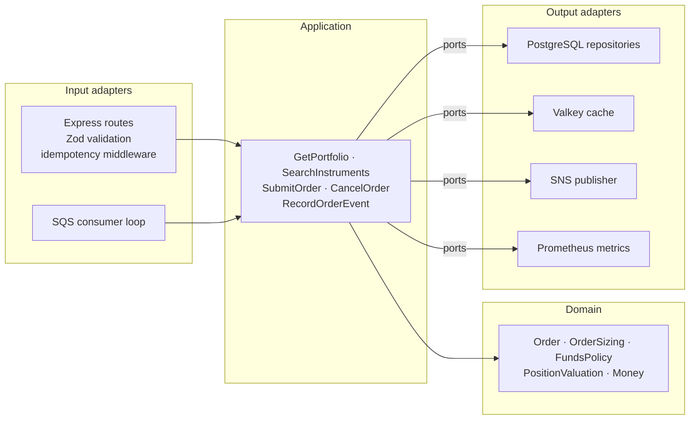
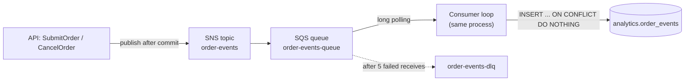
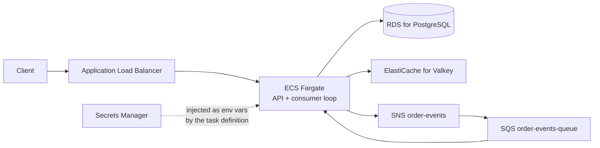

# Architecture

This document describes how the code is organised: layers, folders, ports and adapters, and the services around the API. The diagrams are in `docs/diagrams/cocos-solution.drawio`, pages "Arquitectura hexagonal" and "Arquitectura AWS".

## Layers

Business rules sit in the centre. Everything external enters through adapters that implement ports.

| Layer           | Content                                                                                                                | Depends on       |
| --------------- | ---------------------------------------------------------------------------------------------------------------------- | ---------------- |
| Input adapters  | Express routers, Zod validation, error and request-metrics middleware, `Idempotency-Key` middleware, SQS consumer loop | Application      |
| Application     | Use cases: `GetPortfolio`, `SearchInstruments`, `SubmitOrder`, `CancelOrder`, `RecordOrderEvent`                       | Domain and ports |
| Domain          | `Order` and its statuses, `OrderSizing`, `FundsPolicy`, `PositionValuation`, `Money`                                   | Nothing          |
| Output ports    | Interfaces such as `OrderRepository`, `UnitOfWork`, `Cache`, `EventPublisher`, `OrderMetrics`                          | Domain           |
| Output adapters | PostgreSQL repositories with `pg`, Valkey cache, SNS, log and in-memory event publishers, `PrometheusMetrics`          | Ports            |

## Folders

Code is organised by feature, not by technical layer.

| Folder             | Content                                                                                                                            |
| ------------------ | ---------------------------------------------------------------------------------------------------------------------------------- |
| `src/app.ts`       | `buildApp(deps)`: wires routers and middleware. `AppDeps` lists what the app needs                                                 |
| `src/main.ts`      | Composition root: reads config, builds adapters, starts the server                                                                 |
| `src/config.ts`    | Environment variables, validated with Zod                                                                                          |
| `src/health/`      | `GET /health`                                                                                                                      |
| `src/instruments/` | Search: `application/` (use case, port), `infra/` (PostgreSQL), `http/` (router)                                                   |
| `src/portfolio/`   | Portfolio: `domain/position-valuation.ts`, `application/`, `infra/`, `http/`                                                       |
| `src/orders/`      | Orders: `domain/`, `application/` (`SubmitOrder`, `CancelOrder`, `ports.ts`), `infra/`, `http/`                                    |
| `src/marketdata/`  | Latest quotes: PostgreSQL repository and the cached wrapper                                                                        |
| `src/events/`      | `RecordOrderEvent` use case, the `OrderEventStore` port with its PostgreSQL adapter, and `SqsOrderEventConsumer` (the SQS loop)    |
| `src/metrics/`     | Metrics ports and the no-op implementation, `PrometheusMetrics` (prom-client), request-metrics middleware and `GET /metrics`       |
| `src/shared/`      | `Money`, errors and error middleware, `Cache` and `Clock` ports, cache adapters, database pool, logger, event types and publishers |
| `test/`            | Tests by feature. `test/support/` has the global setup and `createTestApp`                                                         |
| `db/`              | `database.sql` (from the challenge) and `migrations/`                                                                              |

## Ports and adapters

| Port                                                             | Defined in                                         | Adapters                                                                   |
| ---------------------------------------------------------------- | -------------------------------------------------- | -------------------------------------------------------------------------- |
| `OrderRepository`                                                | `orders/application/ports.ts`                      | `PgOrderRepository`                                                        |
| `AccountReader` (orders)                                         | `orders/application/ports.ts`                      | `PgAccountReader` in `orders/infra/`                                       |
| `InstrumentRepository` (orders)                                  | `orders/application/ports.ts`                      | `PgOrderInstrumentRepository`                                              |
| `PriceSource`                                                    | `orders/application/ports.ts`                      | `MarketPriceSource` over the cached market data                            |
| `UnitOfWork`, `Transaction`                                      | `orders/application/ports.ts`                      | `PgUnitOfWork` (transaction plus user row lock)                            |
| `AccountReader` (portfolio)                                      | `portfolio/application/account-reader.ts`          | `PgAccountReader` in `portfolio/infra/`                                    |
| `InstrumentRepository` (search)                                  | `instruments/application/instrument-repository.ts` | `PgInstrumentRepository`                                                   |
| `MarketDataRepository`                                           | `marketdata/market-data-repository.ts`             | `PgMarketDataRepository`, `CachedMarketDataRepository`                     |
| `Cache`                                                          | `shared/ports/cache.ts`                            | `ValkeyCache`, `NoCache`, `InMemoryCache` (tests)                          |
| `Clock`                                                          | `shared/ports/clock.ts`                            | `systemClock`                                                              |
| `EventPublisher`                                                 | `shared/events/order-event.ts`                     | `SnsEventPublisher`, `LogEventPublisher`, `InMemoryEventPublisher` (tests) |
| `OrderEventQueue`                                                | `events/sqs-order-event-consumer.ts`               | `SqsOrderEventQueue`, a fake queue in tests                                |
| `AppMetrics`, `OrderMetrics`, `OrderEventMetrics`, `HttpMetrics` | `metrics/metrics.ts`                               | `PrometheusMetrics`, `noopMetrics`                                         |
| `OrderEventStore`                                                | `events/order-event-store.ts`                      | `PgOrderEventStore`                                                        |

Rules that shape the code:

- SQL goes through `pg`, with no ORM. See [decisions.md](decisions.md).
- The cache never throws. If Valkey fails, adapters read from PostgreSQL.
- `buildApp` takes its dependencies as arguments, so tests swap the cache, publisher, clock and metrics.
- Use cases and the consumer depend on the metrics ports, never on `prom-client`. Recording a metric never fails a request or stops the consumer.

## External services

| Service    | Use                                               | Resource         |
| ---------- | ------------------------------------------------- | ---------------- |
| PostgreSQL | Challenge data and the `analytics` schema         | Database `cocos` |
| Valkey     | Cache for the latest price and for search results | Port 6379        |
| SNS, SQS   | Order events, on AWS Emulator locally             | Port 9297        |
| Prometheus | Scrapes `GET /metrics` every 5 seconds            | Port 9090        |
| Grafana    | Provisioned dashboard "Cocos API"                 | Port 3001        |

Valkey is optional: without `VALKEY_URL` the API uses `NoCache`.

## Events (SNS/SQS)

| Service | Use                                                 | Resource                   |
| ------- | --------------------------------------------------- | -------------------------- |
| SNS     | Receives one event per stored or cancelled order    | Topic `order-events`       |
| SQS     | Queue subscribed to the topic, read by the consumer | Queue `order-events-queue` |
| SQS     | Dead-letter queue, after 5 failed receives          | Queue `order-events-dlq`   |

- The API publishes `order.created` (with the final order status) and `order.cancelled` after the transaction commits. A publish failure is logged and does not undo the order.
- With `AWS_ENABLED=true`, `SnsEventPublisher` publishes to the topic. With `AWS_ENABLED=false`, `LogEventPublisher` writes events to the log and the consumer does not start.
- The consumer is an async loop inside the API process. It long-polls the queue, stores each event in `analytics.order_events` with `ON CONFLICT DO NOTHING`, then deletes the message. If the insert fails, the message is not deleted and SQS redelivers it; after 5 receives it moves to the dead-letter queue. `CONSUMER_ENABLED` turns it on. A receive error is logged and retried after 5 seconds; the loop never crashes, and `stop()` aborts the long poll on shutdown.
- It does not use a `worker_thread` because the work is I/O. If metrics show it slows the API, it moves to its own process in the same repository.

## Metrics

`GET /metrics` exposes Prometheus metrics with `prom-client`. `PrometheusMetrics` owns its own registry (not the global one), created in `main.ts` and passed through `AppDeps`.

| Metric                                    | Type      | Labels                           | Recorded by                                                                                             |
| ----------------------------------------- | --------- | -------------------------------- | ------------------------------------------------------------------------------------------------------- |
| `http_request_duration_seconds`           | Histogram | `method`, `route`, `status_code` | Middleware. `route` is the Express pattern, or `unmatched`                                              |
| `orders_total`                            | Counter   | `status`, `side`, `type`         | `SubmitOrder` per stored order, `CancelOrder` as `CANCELLED`. Not on an idempotent replay               |
| `order_events_processed_total`            | Counter   | none                             | Consumer, per message recorded and deleted                                                              |
| `order_events_failed_total`               | Counter   | none                             | Consumer, per message left in the queue                                                                 |
| `order_event_processing_duration_seconds` | Histogram | none                             | Consumer, per message                                                                                   |
| `order_events_queue_backlog`              | Gauge     | none                             | Consumer, from SQS `ApproximateNumberOfMessages` before each poll. A read failure is logged and ignored |
| `nodejs_*`, `process_*`                   | Various   | Various                          | prom-client default metrics, event loop lag included                                                    |

Grafana dashboard `grafana/dashboards/cocos-api.json` shows orders by status, the rejection ratio, request rate and p95 latency per route, event loop lag, events processed and failed, event processing latency and queue backlog.

## Reference AWS deployment

This deployment is a reference. It is not part of the deliverable. See page "Arquitectura AWS" in the diagram file.

- The API runs on ECS Fargate behind an Application Load Balancer.
- PostgreSQL runs on RDS and Valkey on ElastiCache.
- The database credential lives in Secrets Manager and ECS injects it as an environment variable.
- Analytics data would go to a data warehouse in production.
