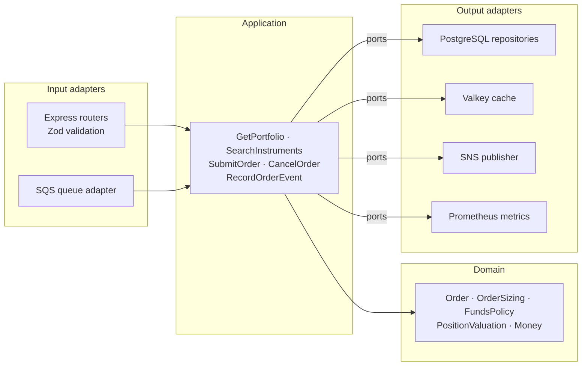
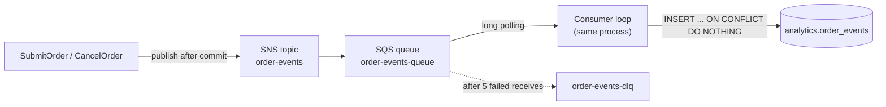
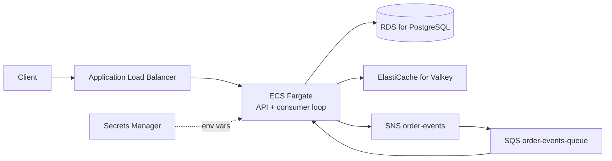

# Architecture

Hexagonal architecture: business rules in the centre, everything external behind ports. The same views are drawn in `docs/diagrams/cocos-solution.drawio`.

## Layers



| Layer       | Content                                          | Knows about          |
| ----------- | ------------------------------------------------ | -------------------- |
| Domain      | Order rules, sizing, funds check, valuation      | Nothing external     |
| Application | Use cases and the ports they need                | Domain and ports     |
| Adapters    | Express, PostgreSQL, Valkey, SNS/SQS, Prometheus | Ports they implement |

Three rules follow from this:

- Use cases do not know HTTP. They throw an error with a code, and one middleware maps codes to statuses.
- SQL is written by hand with `pg`. There is no ORM.
- `buildApp(deps)` takes every dependency as an argument, so tests swap the cache, clock, publisher and metrics.

## Folders

```text
src/
  app.ts  main.ts  config.ts
  modules/                      one folder per feature
    orders/         domain/ application/ infra/ http/
    portfolio/      domain/ application/ infra/ http/
    instruments/    application/ infra/ http/
    marketdata/     domain/ application/ infra/
    order-events/   domain/ application/ infra/
  platform/                     technical code any module can use
    http/  observability/  postgres/  cache/
    errors.ts  money.ts  clock.ts  logger.ts
```

- `src/platform/` never imports from `src/modules/`. ESLint enforces it.
- A module uses another module only through its `application/` ports or `domain/` types. Shared adapters are built once in `src/main.ts`.

## Events



- Publishing never fails a request: an error is logged, and a publish is aborted after 3 seconds.
- A message is deleted only after its event is stored. A failed one is redelivered, and the unique `event_id` makes that harmless.
- With `AWS_ENABLED=false` events are written to the log and the consumer does not start.

## Metrics

`GET /metrics` exposes Prometheus metrics. The Grafana dashboard is `docker/grafana/dashboards/cocos-api.json`; screenshots are in [local-setup.md](local-setup.md#what-a-run-looks-like).

| Metric                                    | Type      | Meaning                                  |
| ----------------------------------------- | --------- | ---------------------------------------- |
| `http_request_duration_seconds`           | Histogram | Latency by method, route and status code |
| `orders_total`                            | Counter   | Stored orders by status, side and type   |
| `order_events_processed_total`            | Counter   | Events stored by the consumer            |
| `order_events_failed_total`               | Counter   | Events left in the queue after a failure |
| `order_event_processing_duration_seconds` | Histogram | Time to store one event                  |
| `order_events_queue_backlog`              | Gauge     | Messages waiting in SQS                  |

## Reference AWS deployment

Not part of the deliverable: how the same pieces would run on AWS.


