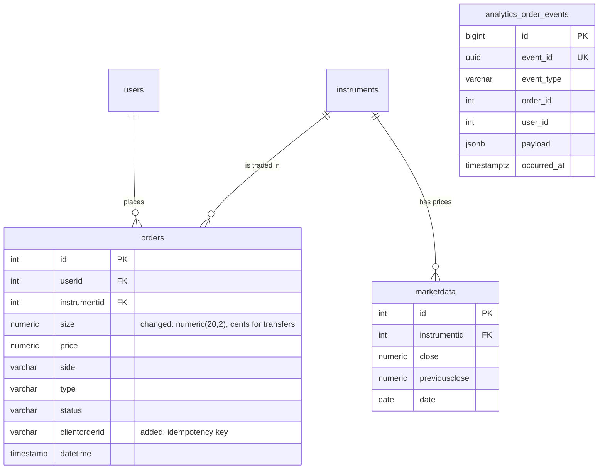

# Decisions

This document records the decisions D-01 to D-24, the schema changes, the discarded alternatives and the known limitations.

## Decisions

| ID   | Decision                      | Resolution                                                                                               | Why                                                        |
| ---- | ----------------------------- | -------------------------------------------------------------------------------------------------------- | ---------------------------------------------------------- |
| D-01 | Cash reserve on buy `LIMIT`   | A `NEW` buy `LIMIT` reserves `size × price` pesos                                                        | Stops the user from committing the same pesos twice        |
| D-02 | Share reserve on sell `LIMIT` | A `NEW` sell `LIMIT` reserves `size` shares                                                              | Same reason, for shares                                    |
| D-03 | Total return                  | `(close − average cost) / average cost`, with the weighted average cost of `FILLED` buys                 | Simple and uses data the orders already hold               |
| D-04 | Daily return                  | Returned per position, next to the total return                                                          | The challenge asks for it per instrument                   |
| D-05 | Negative or zero positions    | Not listed and not added to the total value                                                              | Such positions are data anomalies, not holdings            |
| D-06 | Orders by amount              | `BUY`/`SELL`: whole shares of `amount / price`, zero gives 422. Transfers: size = `amount`, cents kept   | A client mistake is not an order                           |
| D-07 | What is stored as `REJECTED`  | Only missing cash or shares. Malformed requests return 4xx and are not stored                            | `REJECTED` is a business outcome, not a validation error   |
| D-08 | Cancellation                  | `POST /orders/:orderId/cancel`, only from `NEW`                                                          | Only `NEW` orders are open                                 |
| D-09 | `CASH_IN` and `CASH_OUT`      | Sent through `POST /orders`, on the ARS instrument, type `MARKET`, price 1, size in pesos with cents     | Transfers are rows in `orders`, like the seed data         |
| D-10 | Concurrency                   | One transaction with `SELECT ... FOR UPDATE` on the user row, at `READ COMMITTED`                        | Serialises orders of one user without blocking others      |
| D-11 | Schema changes                | Indexes, constraints, one nullable column and one column type change (`size`), in a separate migration   | Minimal changes; `size` must hold transfer cents           |
| D-12 | API contract                  | User in the path or body, pagination with `limit` and `offset`, partial search ignoring case and accents | Predictable and easy to test                               |
| D-13 | Commands                      | Makefile with `make services`, `make dev`, `make up`, `make test`, `make lint` and `make down`           | One entry point; the code adds `make typecheck` for CI     |
| D-14 | Documentation                 | README under 100 lines, detail in `docs/`. Code and docs in English                                      | Quick start first, depth on demand                         |
| D-15 | Secrets                       | The API reads credentials from environment variables. Secrets Manager belongs to a real deployment       | Keeps the code independent of the platform                 |
| D-16 | Event consumer                | Async loop inside the API process, long polling SQS, enabled by `CONSUMER_ENABLED`                       | The work is I/O, and one process is simpler to run         |
| D-17 | Scaling improvements          | Latest-price cache, search cache and idempotency on `POST /orders`                                       | The cheapest changes with the most effect                  |
| D-18 | Duplicate events              | Each event has an `eventId`. Unique key and `ON CONFLICT DO NOTHING` in the analytics table              | SQS delivers at least once                                 |
| D-19 | Cache expiry                  | TTL of 60 seconds for the latest price and 5 minutes for search. If Valkey fails, read PostgreSQL        | Market data does not change here; the cache is best-effort |
| D-20 | Idempotency                   | Required `Idempotency-Key` header on `POST /orders`, stored in `orders.clientorderid`                    | Safe client retries                                        |
| D-21 | Context for AI agents         | `AGENTS.md`, the `agents/` folder and the `run-service` skill                                            | One source of context for any tool                         |
| D-22 | Grafana dashboard             | Datasource and dashboard provisioned, with anonymous read-only access                                    | Works right after startup                                  |
| D-23 | Continuous integration        | GitHub Actions on each push and pull request: lint, type check and tests                                 | Catches regressions early                                  |
| D-24 | Linters and formatting        | Recommended ESLint, typescript-eslint, Prettier and `tsconfig` in `strict` mode. No custom rules         | Standard tools, no maintenance                             |

Assumptions about the challenge data:

- The latest price of an instrument is the `close` of its latest date in `marketdata`, not today's.
- A `MARKET` order on an instrument without `marketdata`, such as PGR or IRCP, returns 422.
- `LIMIT` orders already `FILLED` in the seed count for balances and positions.
- The position of −10 BMA shares for user 1 is a seed anomaly. It is not listed.

## Schema changes

All in `db/migrations/001_constraints_and_analytics.sql`. No existing row changes value: the 11 seed orders keep their sizes.

| Change                                                          | Table         | Why                                                                                                                                                            |
| --------------------------------------------------------------- | ------------- | -------------------------------------------------------------------------------------------------------------------------------------------------------------- |
| Extension `unaccent`                                            | Database      | Search ignores accents                                                                                                                                         |
| Column `clientorderid varchar(64)`, null, unique with `userid`  | `orders`      | Stores the idempotency key next to the order                                                                                                                   |
| Index on `(userid, status, instrumentid)`                       | `orders`      | Balance and position queries filter by user and status                                                                                                         |
| `NOT NULL` on required columns, `CHECK (size > 0)`              | `orders`      | The database refuses orders without size, user or instrument                                                                                                   |
| `CHECK` on `side`, `type` and `status`                          | `orders`      | The database refuses values outside the challenge                                                                                                              |
| Column `size` from `int` to `numeric(20, 2)`                    | `orders`      | Transfers move pesos with cents (size = pesos, price = 1). The challenge computes balances and holdings from `size`, and allows changing tables when justified |
| `CHECK (side IN ('CASH_IN', 'CASH_OUT') OR size = trunc(size))` | `orders`      | Shares stay whole: the database refuses a fractional `BUY` or `SELL`                                                                                           |
| Unique `(instrumentid, date)`                                   | `marketdata`  | One price per day; also serves the latest-close lookup                                                                                                         |
| Unique `ticker`                                                 | `instruments` | Prevents duplicate tickers                                                                                                                                     |
| Schema `analytics`, table `order_events`, unique `event_id`     | New           | History of events stored by the consumer; the key makes redelivery harmless                                                                                    |

## Discarded alternatives

| Alternative            | Why it was discarded                                                                                                                                           |
| ---------------------- | -------------------------------------------------------------------------------------------------------------------------------------------------------------- |
| Balances table         | The challenge asks to compute holdings from `orders`. A second source of truth can drift from the orders and needs updates in every write                      |
| ORM instead of raw SQL | The portfolio is an aggregation query and money is computed in `numeric` in the database. An ORM adds nothing there and hides the row lock. The code uses `pg` |
| `pg_trgm` for search   | `LIKE` with `unaccent` is enough for the size of the data and avoids another extension                                                                         |

## Known limitations

- **Events without outbox.** The event is published after the commit. If the process dies in between, or publishing fails, the order exists and the event is lost. Guaranteed delivery would need an outbox.
- **Average cost ignores realised gains.** Sales do not lower the average cost. It is the simplest convention and does not show gains already taken.
- **Negative BMA position is hidden.** The seed leaves user 1 with −10 BMA shares. The portfolio does not list it and does not count it in the total.
- **Idempotent retry of a `MARKET` order by amount.** Its size depends on a price that may have moved. The retry is matched by user, instrument, side and type only, and returns the stored order.
- **`LIMIT` orders are never executed.** There is no market simulation, so `NEW` orders stay `NEW` until cancelled.
- **Cache staleness.** Prices can be up to 60 seconds old and search results up to 5 minutes old.
