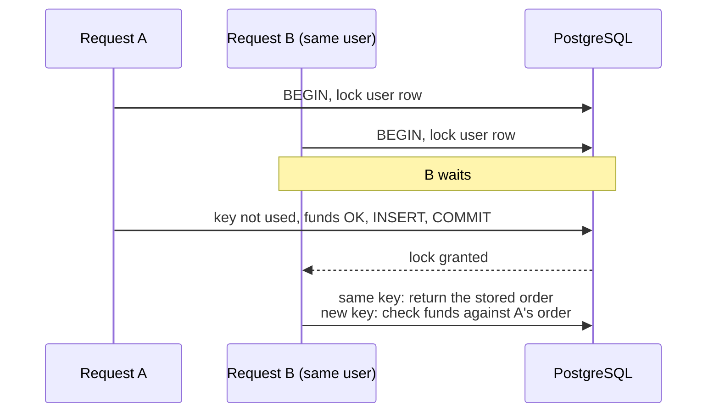
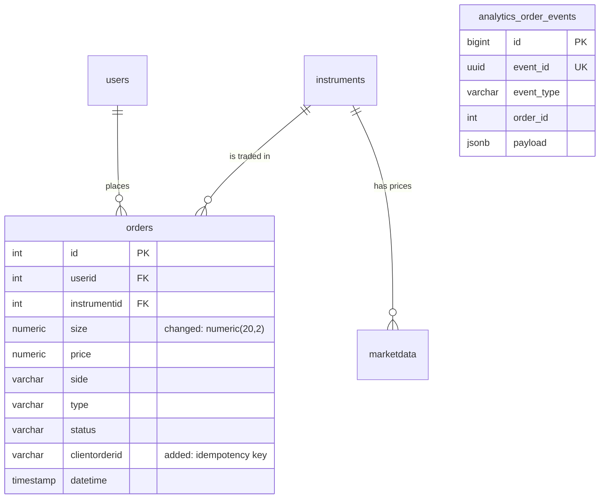

# Decisions

The decisions that shape the code, the schema changes and what the solution does not cover.

## Key decisions

| ID         | Decision                                                                                                      | Why                                                                                           |
| ---------- | ------------------------------------------------------------------------------------------------------------- | --------------------------------------------------------------------------------------------- |
| D-10       | Each order runs in one transaction that locks the user row (`SELECT ... FOR UPDATE`)                          | Two orders of one user cannot spend the same cash or shares                                   |
| D-20       | `POST /orders` requires an `Idempotency-Key`, stored in `orders.clientorderid`                                | A client can retry without creating a second order                                            |
| D-01, D-02 | A `NEW` `LIMIT` order reserves its cash (buy) or shares (sell)                                                | Open orders cannot commit the same funds twice                                                |
| D-07       | Only missing cash or shares is stored as `REJECTED`. A malformed request is a 4xx and stores nothing          | `REJECTED` is a business outcome, not a validation error                                      |
| D-25       | Transfers keep cents: `orders.size` is `numeric(20, 2)`, and a `CHECK` keeps share sizes whole                | The challenge computes balances from `size`                                                   |
| D-09       | `CASH_IN` and `CASH_OUT` go through `POST /orders` on the ARS instrument, at price 1                          | Transfers are rows in `orders`, as in the seed data                                           |
| D-18       | Events carry an `eventId`; the analytics table has a unique key and inserts with `ON CONFLICT DO NOTHING`     | SQS delivers at least once                                                                    |
| D-16       | The event consumer is a loop inside the API process                                                           | The work is I/O, and one process is simpler to run                                            |
| D-19       | Prices are cached 60 seconds and searches 5 minutes. If Valkey fails, the API reads PostgreSQL                | The cache speeds reads up and is never required                                               |
| D-29       | The API runs against a local PostgreSQL built from the challenge's `db/database.sql`, not the hosted database | The solution changes the schema and writes orders, and the hosted database should see neither |
| D-28       | Features live in `src/modules/`, shared technical code in `src/platform/`, each module with the same layers   | The folders show what the system does, and dependencies point in                              |

Money never goes through floating point: it is `numeric` in PostgreSQL, integer cents in the code and a decimal string in JSON.

### Local database instead of the hosted one

The challenge offers a hosted PostgreSQL that already holds the data. This solution does not connect to it. `make services` starts PostgreSQL in Docker and loads `db/database.sql`, the schema and seed file from the challenge repository, followed by the migration.

| Reason              | Detail                                                                                                                 |
| ------------------- | ---------------------------------------------------------------------------------------------------------------------- |
| The schema changes  | The migration adds a column, constraints and indexes. The hosted database is the reference copy, and not ours to alter |
| The API writes      | `POST /orders` inserts rows. The hosted database would no longer hold only the original data                           |
| Runs are repeatable | The container has no volume, so every start restores the seed. Tests start their own container                         |
| No secret to handle | The hosted connection string is never stored in the repository or needed to run the project                            |

Trade-off: the local data is the seed file, not a live copy of the hosted database. When this was written, a read-only comparison showed the same rows in both: 4 users, 66 instruments, 126 market data rows and 11 orders. `DATABASE_URL` can point to any PostgreSQL, but that database needs the migration applied first, because orders are stored with `orders.clientorderid`.

### Concurrency and idempotency

The lock serialises the orders of one user and leaves other users untouched. The idempotency key is looked up after the lock, so two retries that arrive together cannot both insert.

## Schema changes

All in `db/migrations/001_constraints_and_analytics.sql`. No seed row changes value.

| Change                                                              | Why                                     |
| ------------------------------------------------------------------- | --------------------------------------- |
| `orders.clientorderid`, unique with `userid`                        | Idempotency key                         |
| `orders.size` from `int` to `numeric(20, 2)`, whole for shares      | Cents in transfers                      |
| `NOT NULL` and `CHECK` on `side`, `type`, `status` and `size > 0`   | The database refuses invalid orders     |
| Index on `orders (userid, status, instrumentid)`                    | Balance and position queries            |
| Unique `marketdata (instrumentid, date)` and `instruments (ticker)` | One price per day, no duplicate tickers |
| Extension `unaccent`                                                | Search ignores accents                  |
| Schema `analytics` with `order_events`                              | Events stored by the consumer           |

## Discarded alternatives

| Alternative          | Why not                                                                                  |
| -------------------- | ---------------------------------------------------------------------------------------- |
| Balances table       | The challenge asks to compute holdings from `orders`. A second source of truth can drift |
| ORM                  | The portfolio is one aggregation query in `numeric`, and an ORM would hide the row lock  |
| `pg_trgm` for search | `LIKE` with `unaccent` is enough for this data                                           |

## Known limitations

- **No authentication.** The challenge does not ask for it. Any caller can read any portfolio, and place or cancel orders for any user.
- **Events can be lost.** The event is published after the commit, without an outbox. If the process dies in between, the order exists and the event does not.
- **`LIMIT` orders never execute.** There is no market simulation: a `NEW` order stays `NEW` until cancelled.
- **Average cost ignores sales.** Selling does not change the average cost, so realised gains are not shown.
- **Prices are the latest `close` in `marketdata`**, not today's. An instrument without market data cannot be traded at `MARKET` (422).
- **The −10 BMA position of user 1** is a seed anomaly. It is not listed or counted.
- **A retry of a `MARKET` order by amount** returns the stored order even when the price has moved since.
