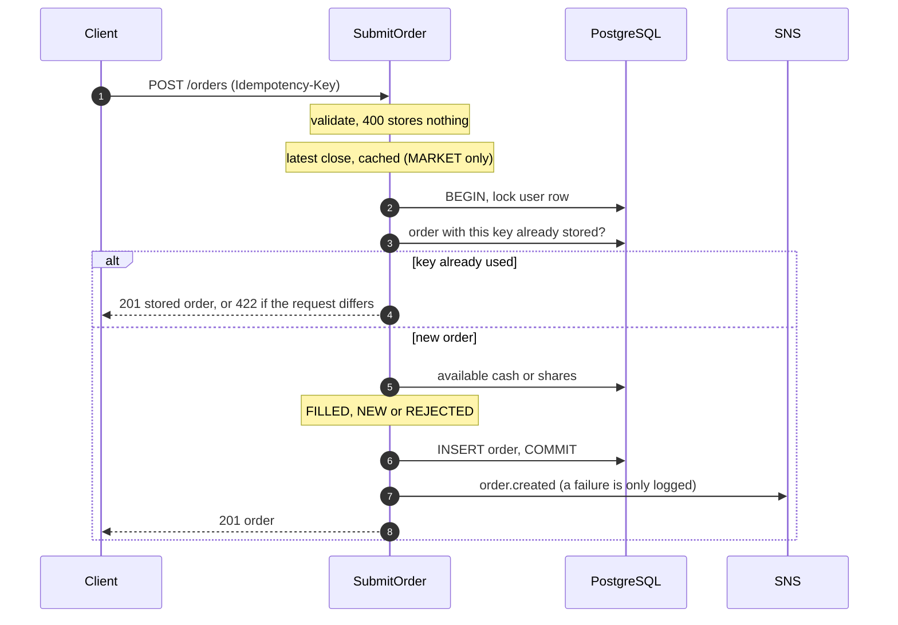
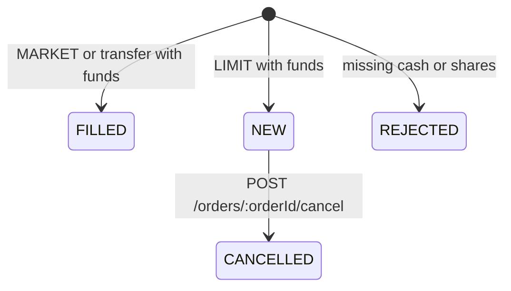
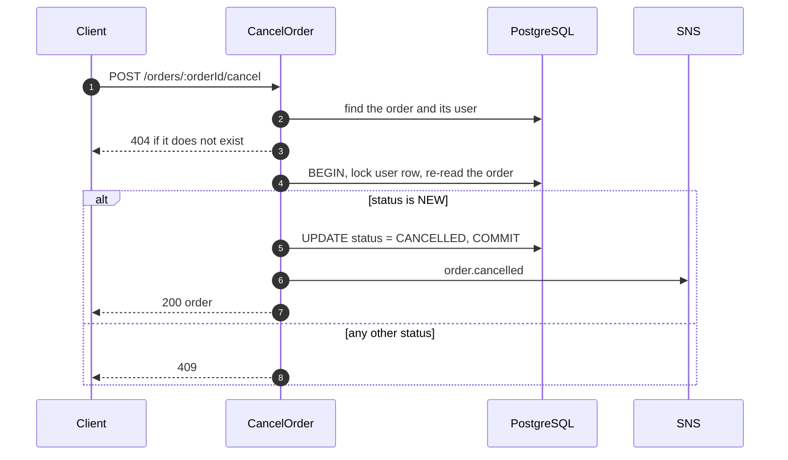
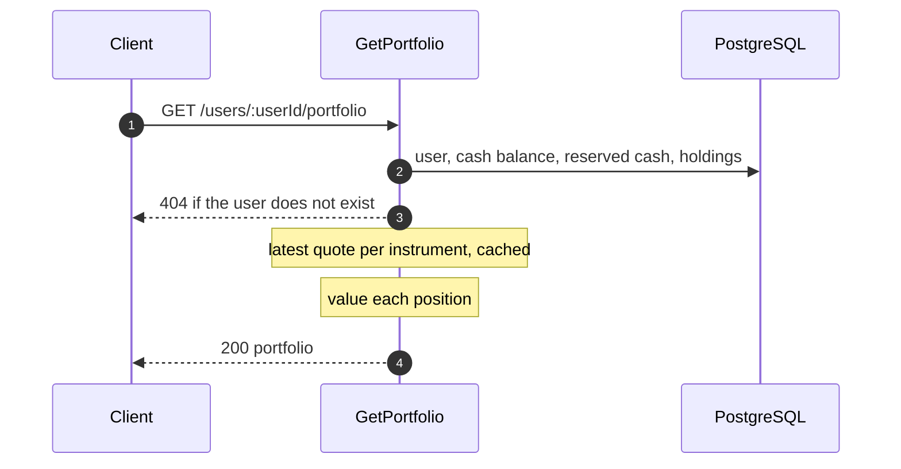
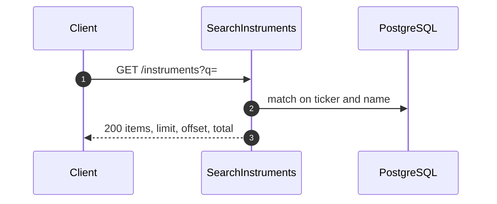
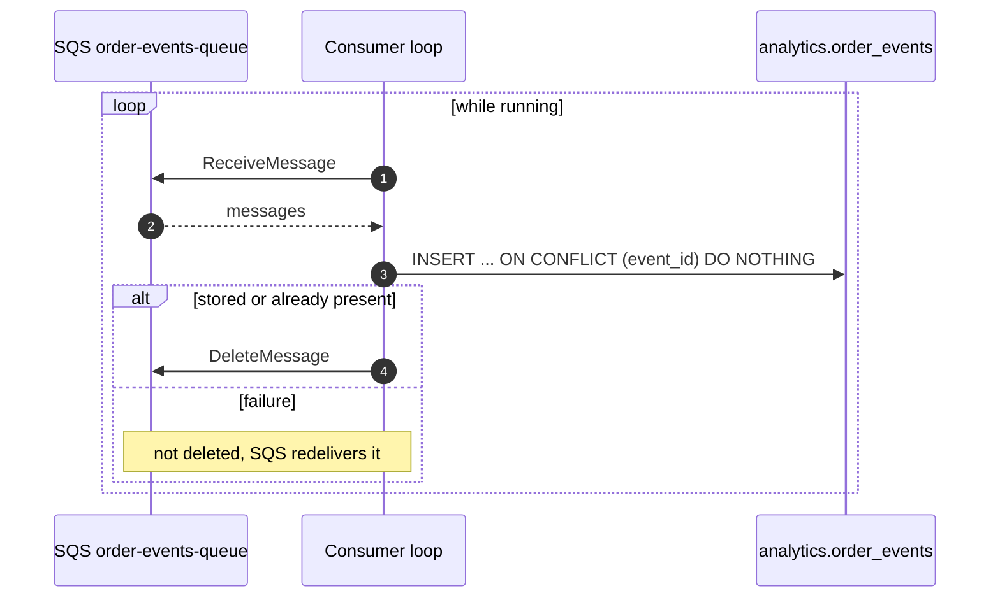

# Flows

One diagram per flow, followed by the rules the diagram cannot show.

## Submit order

`POST /orders`, handled by `SubmitOrder`.

| Order                | Funds or shares | Stored status |
| -------------------- | --------------- | ------------- |
| `MARKET`, `CASH_OUT` | Enough          | `FILLED`      |
| `LIMIT`              | Enough          | `NEW`         |
| Any of the above     | Not enough      | `REJECTED`    |
| `CASH_IN`            | Not checked     | `FILLED`      |

- **Price.** `MARKET` uses the latest `close`, `LIMIT` the price sent, transfers 1.
- **Size.** Sent as whole shares, or derived from `amount` as the whole part of `amount / price`. For a transfer, `amount` is the pesos moved, cents included.
- **Funds.** `size × price` is compared with the available cash in exact cents. Available cash and shares already subtract what `NEW` `LIMIT` orders reserve.
- **Retry.** The same key with the same request returns the stored order. It is not counted or published again.

## Statuses

`NEW` orders are never executed: there is no market simulation.

## Cancel order

`POST /orders/:orderId/cancel`, handled by `CancelOrder`.

The order is read again under the lock, so a cancel cannot race with another request of the same user. Cancelling releases the reservation, because reservations are derived from `NEW` orders.

## Portfolio

`GET /users/:userId/portfolio`, handled by `GetPortfolio`.

| Value               | Formula                                                     |
| ------------------- | ----------------------------------------------------------- |
| Cash balance        | `CASH_IN` + sells − `CASH_OUT` − buys, over `FILLED` orders |
| Reserved cash       | `size × price` of `NEW` buy `LIMIT` orders                  |
| Available cash      | Cash balance − reserved cash                                |
| Quantity            | Buys − sells, over `FILLED` orders                          |
| Average cost        | Cost of the buys / shares bought                            |
| Market value        | Quantity × latest `close`                                   |
| Total return (%)    | `(close − average cost) / average cost × 100`               |
| Daily return (%)    | `(close − previousClose) / previousClose × 100`             |
| Total account value | Cash balance + market value of the positions                |

Positions with a quantity of zero or below are not listed. Balances and orders are always read from PostgreSQL; only quotes are cached.

## Search instruments

`GET /instruments?q=&limit=&offset=`, handled by `SearchInstruments`.

The match is partial and ignores case and accents. Exact ticker matches come first, then ticker prefixes, then the rest. Responses are cached for 5 minutes.

## Event consumer

`OrderEventConsumer`, started when `AWS_ENABLED=true` and `CONSUMER_ENABLED=true`.

A message that keeps failing ends in a dead-letter queue. A consumer error is logged and retried: the loop never stops the API.
