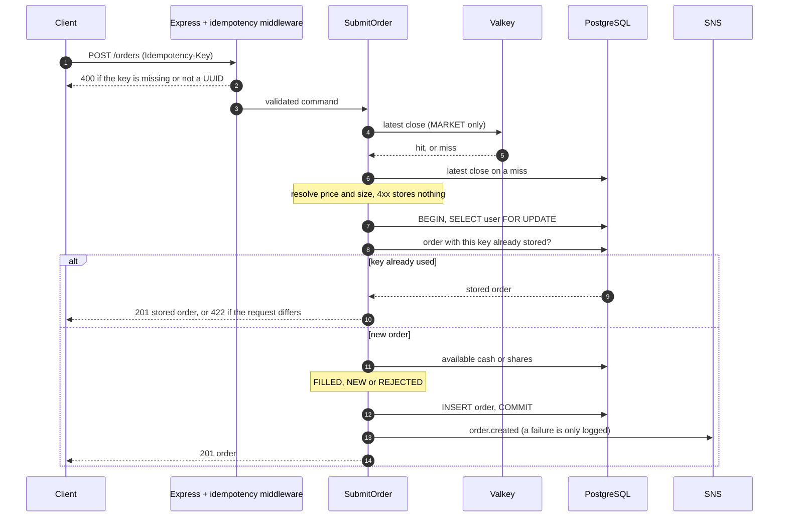
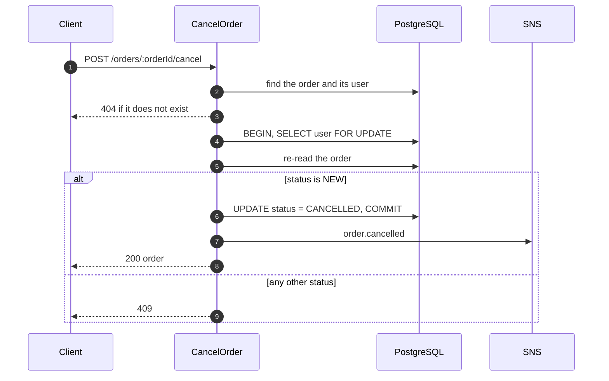
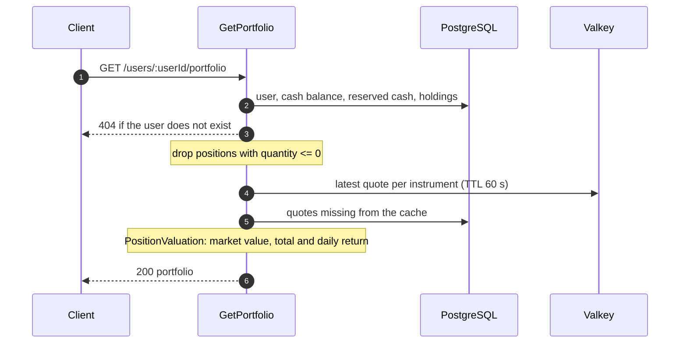
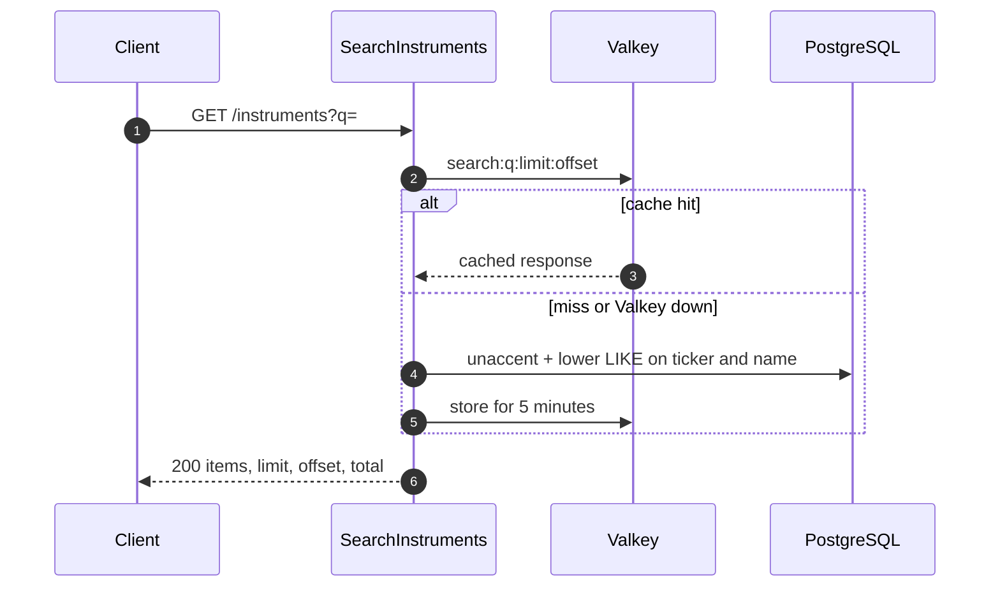
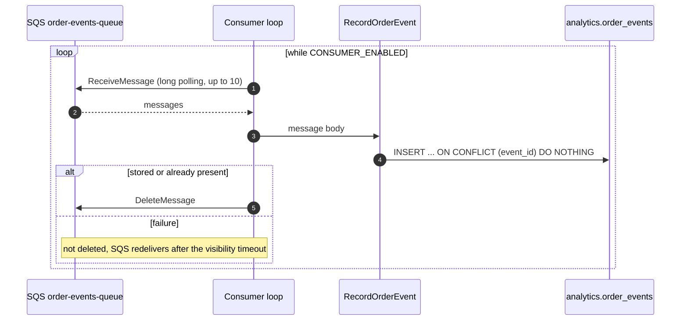
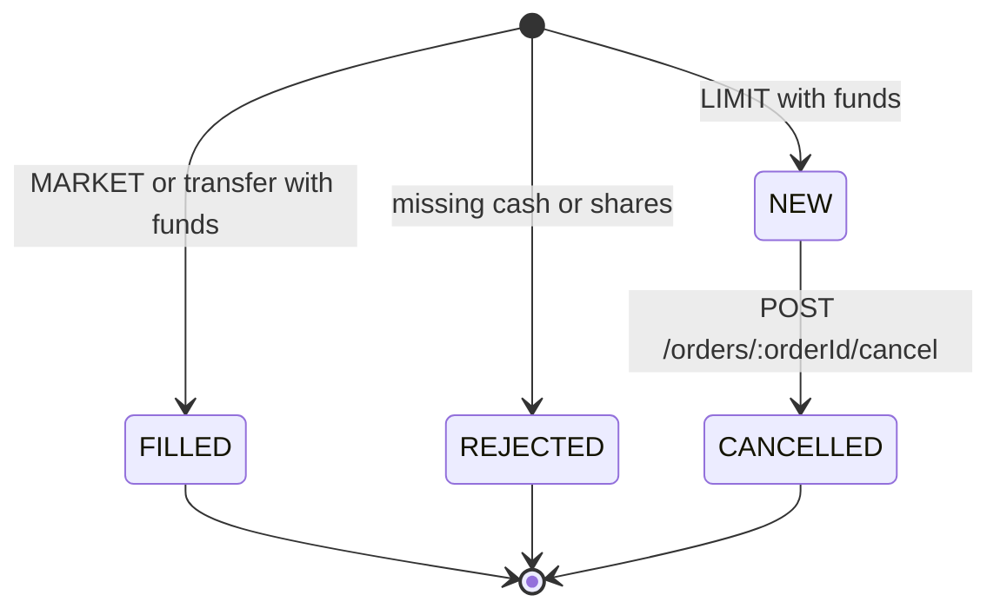

# Flows

This document lists the steps of each flow as the code runs them. The diagrams are on pages "Flujo: enviar orden", "Flujo: cancelar orden", "Flujo: portfolio", "Flujo: buscar activos" and "Flujo: consumidor de eventos" of `docs/diagrams/cocos-solution.drawio`.

## Submit order

`POST /orders`. Handled by `SubmitOrder`. Only step 7 can end in `REJECTED`.

1. Check the `Idempotency-Key` header. It must be a UUID. Otherwise respond 400.
2. Validate the body with Zod (shape, ranges, exactly one of `size` or `amount`, `price` rules). Otherwise respond 400.
3. Resolve the instrument. `CASH_IN` and `CASH_OUT` default to the ARS instrument. Unknown instrument: 404. `BUY` or `SELL` on ARS, or a transfer on another instrument: 422.
4. Resolve the price. `MARKET` uses the latest `close` (cache first, then PostgreSQL); no market data gives 422. `LIMIT` uses the price sent. Transfers use 1.
5. Resolve the size. `size` is used as sent. With `amount`, size is the whole part of `amount / price`; zero gives 422. A size above 2147483647 gives 422.
6. Open a transaction and lock the user row with `SELECT ... FOR UPDATE` (`READ COMMITTED`). Unknown user: 404.
7. Look up the idempotency key for this user. If an order exists, compare it with the request: same request returns the stored order (201), different request gives 422. No further steps run.
8. Check funds or holdings. `BUY` and `CASH_OUT`: `size × price` must not exceed available cash. `SELL`: `size` must not exceed available shares. `CASH_IN` always passes. Available values already subtract the reservations of `NEW` `LIMIT` orders.
9. Insert the order with its final status and the key in `clientorderid`, then commit.
10. Count the order in `orders_total` and publish `order.created` after the commit. A failure of either is logged and the response is still 201. A replay from step 7 is neither counted nor published.
11. Respond 201 with the order.

| Type       | Funds or holdings check | Stored status          |
| ---------- | ----------------------- | ---------------------- |
| `MARKET`   | Passes                  | `FILLED`               |
| `MARKET`   | Fails                   | `REJECTED`             |
| `LIMIT`    | Passes                  | `NEW`                  |
| `LIMIT`    | Fails                   | `REJECTED`             |
| `CASH_IN`  | Not applicable          | `FILLED`               |
| `CASH_OUT` | Passes or fails         | `FILLED` or `REJECTED` |

A retry of a `MARKET` order is matched by user, instrument, side and type. Its size (when sent as `amount`) and price are not compared, because they depend on a price that may have moved. A `LIMIT` order or an order sent with `size` also compares size, and a `LIMIT` compares price.

## Cancel order

`POST /orders/:orderId/cancel`. Handled by `CancelOrder`.

1. Check that `orderId` is a positive integer. Otherwise respond 400. An id beyond the `integer` range gives 404.
2. Read the order to find its owner. Not found: 404.
3. Open a transaction and lock the owner's user row.
4. Read the order again under the lock. If its status is not `NEW`, respond 409.
5. Set the status to `CANCELLED` and commit. The reservation is released because it is derived from `NEW` orders.
6. Count the order in `orders_total` as `CANCELLED` and publish `order.cancelled` after the commit. A failure is logged.
7. Respond 200 with the order.

## Portfolio

`GET /users/:userId/portfolio`. Handled by `GetPortfolio`.

1. Check that `userId` is a positive integer. Otherwise respond 400. An id beyond the `integer` range gives 404.
2. Check the user exists. Otherwise respond 404.
3. Read the cash balance and the reserved cash from `orders`, and the net holdings per instrument from `FILLED` orders.
4. Drop holdings with quantity zero or below.
5. Read the latest quote of each held instrument: Valkey first (TTL 60 seconds), then PostgreSQL for the misses.
6. Value each position and the account. Positions are sorted by ticker.
7. Respond 200. Order and balance data is always read from PostgreSQL.

Formulas:

| Value               | Formula                                                       | Orders counted  |
| ------------------- | ------------------------------------------------------------- | --------------- |
| Cash balance        | `CASH_IN` + sells − `CASH_OUT` − buys, each as `size × price` | `FILLED`        |
| Reserved cash       | Sum of `size × price` of buy `LIMIT` orders                   | `NEW`           |
| Available cash      | Cash balance − reserved cash                                  |                 |
| Quantity            | Buys − sells, in `size`                                       | `FILLED`        |
| Available shares    | Quantity − `size` of sell `LIMIT` orders                      | `FILLED`, `NEW` |
| Average cost        | Sum of `size × price` of buys / sum of `size` of buys         | `FILLED`        |
| Market value        | Quantity × latest `close`                                     |                 |
| Total return (%)    | `(close − average cost) / average cost × 100`                 |                 |
| Daily return (%)    | `(close − previousClose) / previousClose × 100`               |                 |
| Total account value | Cash balance + sum of market values                           |                 |

The total uses the full cash balance, not the available cash. Percentages and amounts have two decimals and are returned as strings.

## Search instruments

`GET /instruments?q=&limit=&offset=`. Handled by `SearchInstruments`.

1. Validate the query: `q` is required and non-empty, `limit` is 1 to 100 (default 20), `offset` is 0 or more (default 0). Otherwise respond 400.
2. Lowercase and trim `q`, then look up the key `search:{q}:{limit}:{offset}` in Valkey (TTL 5 minutes).
3. On a miss, query PostgreSQL. The match is partial on ticker or name, ignoring case and accents. Exact ticker matches come first, then ticker prefix matches, then the rest by ticker. Each item carries the latest `close`.
4. Store the result in the cache and respond 200 with `items`, `limit`, `offset` and `total`.

## Event consumer

`SqsOrderEventConsumer`, started by `main.ts` when `AWS_ENABLED=true` and `CONSUMER_ENABLED=true`.

1. Read the queue backlog (`ApproximateNumberOfMessages`) into `order_events_queue_backlog`. A failure is logged and ignored.
2. Long-poll `order-events-queue` (20 seconds, up to 10 messages). A receive error is logged and the loop waits 5 seconds.
3. For each message, unwrap the SNS envelope if present and validate the event with Zod.
4. Insert it into `analytics.order_events` with `ON CONFLICT (event_id) DO NOTHING`.
5. Delete the message from the queue and count it in `order_events_processed_total`.
6. If step 3, 4 or 5 fails, count it in `order_events_failed_total` and do not delete it. SQS redelivers it after the 30-second visibility timeout; after 5 receives it moves to `order-events-dlq`. The unique `event_id` makes redelivery harmless.

Each message's time from step 3 to 5 or 6 goes to `order_event_processing_duration_seconds`.

## Statuses

| Status      | Meaning                                                  | How it is reached                                       |
| ----------- | -------------------------------------------------------- | ------------------------------------------------------- |
| `NEW`       | `LIMIT` order accepted, waiting. Reserves cash or shares | `LIMIT` order that passes the funds check               |
| `FILLED`    | Executed. Counts for balances and positions              | Accepted `MARKET` order, `CASH_IN`, accepted `CASH_OUT` |
| `REJECTED`  | Stored, not executed                                     | Missing cash or shares only                             |
| `CANCELLED` | Cancelled by the client                                  | `POST /orders/:orderId/cancel` on a `NEW` order         |

`LIMIT` orders in `NEW` are never executed. There is no market simulation.

## Errors

Error body: `{ "error": { "code", "message", "details"? } }`. Codes are `BAD_REQUEST`, `NOT_FOUND`, `CONFLICT`, `UNPROCESSABLE_ENTITY` and `INTERNAL_ERROR`.

| Case                                                             | Status |
| ---------------------------------------------------------------- | ------ |
| Missing fields, wrong types, `size` or `amount` of zero or below | 400    |
| `size` and `amount` together, or neither                         | 400    |
| `LIMIT` without `price`, or `MARKET` with `price`                | 400    |
| Missing or non-UUID `Idempotency-Key`                            | 400    |
| Malformed JSON body                                              | 400    |
| Non-numeric `orderId` or `userId`, or missing `q`                | 400    |
| Unknown user, instrument, order or route                         | 404    |
| `BUY` or `SELL` on ARS, or a transfer on another instrument      | 422    |
| `MARKET` on an instrument without market data                    | 422    |
| `amount` that does not cover one unit                            | 422    |
| `Idempotency-Key` reused with a different request                | 422    |
| Cancel an order that is not `NEW`                                | 409    |
| Unhandled error                                                  | 500    |
| Database unreachable on `GET /health`                            | 503    |

An order rejected for missing cash or shares is not an error. It returns 201 with `status: "REJECTED"` because the order was stored.
